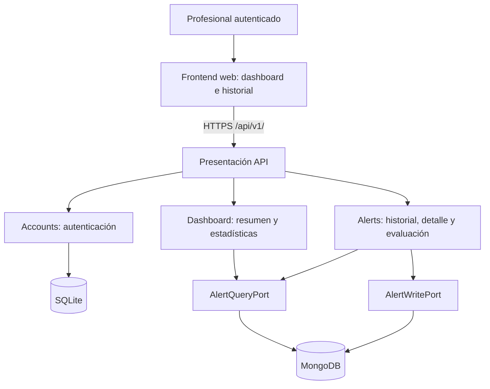

# Arquitectura — Psycode API

> Separación implementada: el agente instalable está en el repositorio independiente
> `psycode-agent`. El control remoto y la operación vigente se describen en
> [OPERACION-SEPARADA.md](docs/OPERACION-SEPARADA.md) y
> [CONTROL-Y-AUDIO.md](docs/CONTROL-Y-AUDIO.md). Las secciones históricas que
> presentaban el transporte como pendiente quedan sustituidas por esos contratos.


**Estado:** arquitectura SCRUM-30 conservada. Accounts (SCRUM-31) y persistencia MongoDB de alertas (SCRUM-32) están implementados. Consultas HTTP, evaluación pública y notificaciones siguen pendientes. Nombre técnico `psycode-api`; API pública `/api/v1/`. Ver [SCRUM-31](docs/SCRUM-31.md), [SCRUM-32](docs/SCRUM-32.md) y [esquema MongoDB](docs/MONGODB.md).

## 1. Decisión y alcance

Un **monolito modular con capas ligeras** permite desplegar un solo backend y repartir trabajo por módulos. Los contratos separan el desarrollo de frontend, consultas, persistencia, evaluaciones y notificaciones. Las capas son responsabilidades dentro de cada módulo, no servicios distribuidos.

No se incorporan microservicios, buses de eventos, CQRS, contenedores de inyección, repositorios genéricos ni componentes de negocio preconstruidos. SCRUM-71 incorpora [sesiones persistentes de captura y su bandeja de órdenes SQL](backend/apps/capture/README.md), integradas con la autorización de SCRUM-70. La ingesta interna agrega almacenamiento privado temporal y una cola SQL de fragmentos, sin broker externo ni consumidor automático. No incorpora ejecución de captura, gestión de pacientes ni CRUD público de sesiones/boxes. Para alertas, `sesion_id` y `box` siguen siendo referencias recibidas por el caso de uso interno de registro, sin relación entre bases de datos.

### Base tecnológica prevista

| Tecnología | Uso |
|---|---|
| Python 3.12 y Django 5.2, con parche mantenido al implementar | Base de referencia del equipo; compatible con el mínimo Python 3.10+ del handoff |
| Django REST Framework | Validación HTTP, vistas y serialización explícita |
| Simple JWT | Emisión y validación de tokens; rotación y revocación de refresh |
| ORM y autenticación de Django + SQLite | Usuarios, contraseñas, recuperación y estado de tokens |
| PyMongo | Controlador oficial para alertas y evaluaciones; no usar el ORM relacional para MongoDB |
| Correo SMTP mediante Django; adaptador Teams desacoplado | Adaptadores de notificación propios |

La elección de librerías base fue confirmada por Martin. SCRUM-31 fija dependencias en pyproject.toml y uv.lock, con requirements.txt exportado para pip. Se agregan django-cors-headers y python-dotenv para el origen frontend y configuración local. Versiones efectivamente verificadas y comandos en [README](README.md).

## 2. Módulos, capas y dependencias

```text
backend/
  config/             composición, configuración y rutas raíz
  common/             respuestas, errores y auditoría técnica compartida
  apps/
    accounts/         autenticación y recuperación
    alerts/           persistencia, consulta y evaluación de alertas
    dashboard/        resumen y estadísticas sobre alertas
    notifications/    correo principal según configuración operativa
    agenda/           carga manual Excel y consulta temporal de ocupación
    capture/          sesiones, órdenes, ingesta de archivos y cola persistente SQL
```

Cada carpeta de código incluye su propio README. Accounts ya tiene capas implementadas, migraciones, comando y tests; las otras apps tienen archivos base sin comportamiento. Solo se crearán subcarpetas adicionales cuando su contenido lo justifique.

El servicio interno [agenda](backend/apps/agenda/README.md) reúne lectura Excel, validación y consultas en memoria en `services.py`, con pruebas en `tests.py`.

| Capa | Archivos previstos | Regla |
|---|---|---|
| Presentación/API | `urls.py`, `views.py`, `serializers.py` | Recibe HTTP, valida estructura, identifica usuario, delega y traduce resultado/errores |
| Aplicación | `services.py` | Coordina casos de uso, permisos y efectos explícitos |
| Dominio | `domain.py` | Tipos y reglas del negocio sin imports de Django, DRF, PyMongo ni clientes de red |
| Infraestructura | `repositories.py`, `clients.py`; `models.py` en accounts | Implementa almacenamiento y comunicación externa |

Los servicios de alertas reciben interfaces específicas definidas en `alerts/ports.py`, implementadas por infraestructura. Se pasan como argumentos o dependencias de constructor; `config` conecta las implementaciones. Los objetos de intercambio serán estructuras tipadas de Python, sin `Request`, `Response`, `QuerySet`, `ObjectId` ni cursores de MongoDB.

- API → aplicación → dominio e interfaces de almacenamiento/envío.
- Infraestructura implementa interfaces e interpreta resultados del proveedor.
- Dashboard usa `AlertQueryPort`, no importa el repositorio concreto de MongoDB.
- Alerts recibe un `AlertNotifier` implementado por notifications; no conoce la URL de Teams.
- Notifications no consulta ni modifica alertas: recibe el payload ya permitido.
- Accounts aprovecha autenticación, hashing y recuperación de Django; no reimplementa criptografía ni replica su modelo de usuarios en un segundo dominio.
- Common no importa módulos de negocio y no recibe lógica específica de alertas.
- La orquestación de registro y envío es explícita; no se oculta en señales de guardado.

### Contratos de colaboración

Firmas conceptuales que deben respetar las futuras implementaciones. Los DTO de alerta, evaluación, página y notificación se definen por los campos de [API_CONTRACTS.md](API_CONTRACTS.md); estas firmas no son endpoints adicionales.

| Interfaz / método previsto | Entrada | Salida / condición |
|---|---|---|
| `AlertQueryPort.list_alerts(filters, limit, offset)` | Filtros normalizados del contrato | `AlertPage`: total e items tipados, sin envelope HTTP |
| `AlertQueryPort.get_alert(alerta_id)` | UUID | `AlertDetail` o `AlertNotFound` |
| `AlertQueryPort.get_evaluation(alerta_id)` | UUID | `Evaluation` o `AlertNotFound` / `EvaluationNotFound` |
| `AlertQueryPort.summarize(start_utc, end_utc)` | Intervalo con fin exclusivo | Total, pendientes, revisadas y conteos por semáforo |
| `AlertQueryPort.daily_counts(start_utc, end_utc, timezone)` | Intervalo y zona Santiago | Lista ordenada de fecha local y total |
| `AlertWritePort.insert_alert(alert)` | Alerta validada sin evaluación | Alerta persistida o `AlertAlreadyExists` |
| `AlertWritePort.record_evaluation(alerta_id, evaluation)` | UUID y evaluación con autor autenticado | Evaluación registrada o `AlertNotFound` / `EvaluationAlreadyRegistered` |
| `AlertNotifier.notify_alert(alerta_id, payload)` | UUID para auditoría y payload mínimo | `NotificationResult`; no borra ni modifica la alerta |
| `AuditWriter.record(event)` | Evento técnico con resultado | Escritura de auditoría; sin datos clínicos libres ni secretos |

`AlertsService` expondrá `register_alert`, `list_alerts`, `get_alert`, `record_evaluation` y `get_evaluation`; `DashboardService`, `get_summary` y `get_statistics`; `AccountsService`, `login`, `refresh`, `logout`, `get_current_user`, `request_password_reset` y `confirm_password_reset`. Los errores tipados se traducen a los códigos públicos en presentación. No se exponen trazas internas al cliente.

## 3. Persistencia y flujos

### SQLite

Accounts tendrá un usuario propio basado en las capacidades de Django, con UUID estable desde la primera migración. Conservará usuario, correo institucional único, nombre, contraseña hasheada y estado activo. Los nombres internos de Django se traducen a los nombres públicos del contrato. El usuario se define antes de iniciar migraciones; los usuarios de prueba pertenecen a SCRUM-31.

Refresh y revocaciones se almacenan en SQLite. La sesión de autenticación no es la sesión clínica indicada por `sesion_id`. No se crean relaciones SQL con colecciones MongoDB.

SCRUM-71 almacena además `CaptureSession`, `AgentCommand`, `AcceptedSequence` y
`CaptureEvent` en SQL. La sesión y sus órdenes/eventos se confirman atómicamente.
La bitácora técnica de captura se mantiene en SQL y el logger compartido; la
consulta MongoDB de bitácora de alertas conserva su contrato. El agente consume
una interfaz interna con DTO; su transporte y ejecución pertenecen al adaptador
del box. La ingesta implementa `POST /api/v1/internal/fragments` con credenciales
de agente vinculadas al box, separadas del JWT profesional. Guarda archivos
temporales en un volumen local privado (Windows, macOS o Linux) y `FragmentJob` en SQL, relacionado uno
a uno con la secuencia aceptada. La clave única sesión/secuencia y el bloqueo
de sesión evitan duplicados entre procesos. Archivo validado y sincronizado a
disco precede a la transacción que registra secuencia, trabajo pendiente y
bitácora; la confirmación HTTP ocurre después del commit. Una caída puede dejar
un archivo huérfano, pero no una aceptación confirmada sin trabajo.

No hay transacción distribuida con archivos. La limpieza
`cleanup_capture_uploads` recupera huérfanos antiguos sin referencias SQL y
omite cargas en curso mediante locks de archivo. Ante un commit de resultado
incierto conserva el archivo y permite resolver la aceptación con un reintento.
No borra archivos de trabajos activos o terminados. El consumidor de esta cola
y la eliminación de archivos aceptados después del procesamiento quedan para
la integración del trabajador. No se inicia análisis desde la vista ni al
importar Django. [Contrato de ingesta y límites](API_CONTRACTS.md#5-ingesta-interna-de-fragmentos).

### MongoDB

Esquema, invariantes, índices y datos prohibidos: [docs/MONGODB.md](docs/MONGODB.md). Dos colecciones en la base `psycode`: `alerts` (negocio) y `audit_events` (bitácora de alta, evaluación y envío). No hay colecciones de sesiones, boxes, pacientes ni usuarios.

Colección `alerts`, con `alerta_id` UUID serializado canónicamente como string e índice único. Fechas almacenadas como fechas UTC, serializadas ISO 8601. `semaforo` se deriva de `nivel_severidad`; no se permite una segunda fuente contradictoria. Las evaluaciones se incrustan como objeto único `evaluacion` o `null` en el mismo documento. `box` y `sesion_id` son referencias (string y UUID); la sesión clínica no es la sesión JWT.

Una evaluación guarda UUID del profesional y una copia de su identificador visible (`usuario`) al evaluar. No depende de una consulta posterior a SQLite para reconstruir la trazabilidad. El actor llega del contexto autenticado, nunca del JSON enviado por el frontend.

La actualización de `evaluacion`, `estado_evaluacion` y `trazabilidad.actualizada_en` será atómica y condicionada a `estado_evaluacion=pendiente`. Dos solicitudes concurrentes no pueden registrar dos evaluaciones: una obtiene éxito y la otra conflicto. La consulta distinguirá conflicto de alerta inexistente.

Índices previstos: unicidad de `alerta_id`; orden por `fecha_hora` y `alerta_id`; filtros por `box`/fecha y por `estado_evaluacion`/fecha. No se introduce un buscador externo para `q`.

### Bitácora consultable (SCRUM-65)

`GET /api/v1/audit-events` requiere JWT y un usuario activo con rol administrador o supervisor (también superusuario). Permite filtrar por período UTC, UUID de alerta, acción y resultado, con paginación y orden estable por timestamp/event_id. No hay interfaz visual de consulta ni escritura pública.

`AlertAudit` genera una sola vez event_id y timestamp, emite el evento al logger y persiste el mismo evento en MongoDB. Los automáticos tienen actor `Sistema`; una evaluación registra `Usuario` y su UUID, sin nombre ni correo. Los fallos del trabajador incluyen sesión y secuencia; una excepción de flujo registra `FLOW_INTERRUPTED`. Una caída de MongoDB deja el mismo event_id en el logger para correlación; no hay cola de recuperación de auditoría.

### Registro y notificación

```text
Entrada interna validada
  → guardar alerta en MongoDB
  → si nivel BAJO/MEDIO/ALTO: consultar destinatarios operativos actuales
      → un intento individual por destinatario, continuando ante fallos
      → éxito total, fallo parcial, fallo total o sin destinatarios
  → registrar resultado de cada intento
```

El trabajador de análisis usa `composition.alerts_service()` para persistir y después notificar. `AlertsService` admite un notificador inyectado; los datos sintéticos usan el servicio sin notificador. Los datos de prueba invocarán el registro con envío deshabilitado por defecto. No habrá `POST /alerts` público en esta fase.

Los fallos de MongoDB impiden el registro y el envío. Los fallos de notificación no revierten una alerta guardada. La auditoría técnica se emite en el logger `psycode.audit`. Los eventos `alerts.register`, `alerts.evaluate`, cada intento `notifications.send` y los fallos `analysis.speechmatics`/`analysis.jev`/`alerts.flow` se persisten además en `audit_events`; los de autenticación permanecen solo en el log. Los fallos de análisis previos a una alerta usan `alerta_id=null` y códigos permitidos sin texto ni respuestas de proveedor. Un fallo al escribir la bitácora no revierte la alerta y se dirige al log de error local, nunca como prueba de entrega.

El módulo interno de [análisis Speechmatics + JEV](docs/INTEGRACION-SPEECHMATICS-JEV.md) se compone para un trabajador secuencial, mediante puertos y salida tipada [1.0](docs/analysis/OUTPUT-1.0.md). No inicia procesos al importar Django ni añade rutas públicas de ingesta.

El correo principal utiliza la configuración operativa: `primary_email` en lista de distribución o los correos registrados de todos los supervisores habilitados. Cada mensaje lleva un único destinatario. No se usan destinatarios antiguos del entorno ni se ejecuta respaldo. Solo el remitente/relay usa credenciales SMTP. El proceso SMTP se cancela al superar `EMAIL_TIMEOUT_SECONDS`, que limita cada intento completo; no queda un hilo enviando después del timeout. La aceptación SMTP no prueba entrega ni lectura, y un timeout puede dejar incierta la aceptación previa por el relay.

Teams queda deshabilitado (`TEAMS_ENABLED=False`) y no participa del flujo, aunque exista una URL en el entorno. Se conserva su adaptador desacoplado hasta decidir webhook y responsables. `NOTIFICATIONS_ENABLED=false` mantiene todos los envíos desactivados por defecto.

La secuencia es síncrona y acotada según el contrato. No hay transacción entre MongoDB, SQLite y correo, ni garantía de entrega exactamente una vez. Una caída entre persistir y notificar puede dejar una alerta sin aviso; la recuperación automática duradera queda fuera del backlog actual. Esta limitación debe revisarse antes de uso clínico real.

## 4. Capa de frontend — dashboard e historial de alertas

**Estado: diseño arquitectónico, pendiente de implementación.** La aplicación web permitirá a profesionales autenticados consultar el historial de alertas de riesgo de suicidio, revisar su detalle y registrar su evaluación. El dashboard será el punto de entrada después del inicio de sesión. Cubre SCRUM-35, 36, 37, 39 y 40; el stack frontend se definirá al activar esas tareas, según el handoff.

### Ubicación y dependencias



El navegador consume la API pública; las credenciales de persistencia y notificación permanecen en el backend. `backend/apps/dashboard` proporciona agregaciones; la pantalla dashboard pertenece al frontend. El servidor verifica autenticación y permisos en cada operación protegida.

Estructura conceptual propuesta, sin crear código ni fijar una librería:

```text
frontend/
  app/                navegación, composición y acceso protegido
  features/
    auth/             inicio, recuperación y cierre de sesión
    dashboard/        indicadores, período y estadísticas
    alerts/           historial, filtros, detalle y evaluación
    evaluations/      consulta de evaluaciones registradas
  shared/
    api/              cliente HTTP, autenticación y errores
    ui/               tabla, paginación, semáforo y estados de pantalla
    formatting/       presentación de fechas y etiquetas
```

| Responsabilidad | Regla |
|---|---|
| Pantallas y componentes | Presentan datos, recogen acciones y muestran carga, vacío, error o éxito |
| Coordinación por funcionalidad | Mantiene filtros, período, página y selección; solicita datos y actualiza vistas |
| Cliente de API compartido | Construye solicitudes contractuales, interpreta envelopes y centraliza la renovación de sesión |
| Formato de presentación | Muestra fechas en `America/Santiago` y semáforos con etiquetas además de color |

Las pantallas no duplican reglas clínicas ni agregaciones. El backend determina severidad, estado, evaluación, autor y fecha de registro.

### Pantallas y contratos

Las rutas web son propuestas de navegación, distintas de los endpoints. Todos los endpoints de la tabla llevan el prefijo `/api/v1`.

| Pantalla / ruta web propuesta | Contenido | API consumida |
|---|---|---|
| Autenticación `/login`, `/recuperar-password`, `/reset-password` | Inicio, recuperación y entrada al dashboard | Operaciones `/auth/*` del contrato |
| Dashboard `/dashboard` | Total, pendientes, revisadas, conteos por semáforo y acceso visible al historial; selector semanal/mensual y fecha de referencia | `GET /dashboard/resumen` |
| Estadísticas `/estadisticas` | Conteos diarios, total, historial del período y regreso al dashboard | `GET /dashboard/estadisticas` |
| Historial `/alertas` | Tabla paginada, búsqueda, filtros combinables y apertura de detalle | `GET /alerts` |
| Detalle, modal desde historial | Datos de la alerta, evaluación existente y formulario para pendientes | `GET /alerts/{alerta_id}`, `GET` y `POST /alerts/{alerta_id}/evaluacion` |
| Registro `/evaluaciones` | Alertas revisadas, resultado, autor, fecha/hora de evaluación y acceso al detalle | `GET /alerts?revisadas=true`; evaluación incluida en cada fila |

### Flujo del dashboard al historial

1. Tras autenticar, cargar el resumen del período seleccionado. Las estadísticas usan el mismo `periodo` y `fecha_referencia`.
2. «Ver historial del período» pasa `fecha_desde` y `fecha_hasta` inclusivas devueltas por el backend a `GET /alerts`. «Ver todo el historial» abre la consulta sin restricción de fechas.
3. Cada fila muestra identificador, box, tipo de riesgo, severidad/semáforo, fecha, hora y estado de evaluación. Se respeta el orden del servidor: fecha/hora descendente y UUID ascendente en empates.
4. Buscar con `q` por identificador, box o tipo de riesgo; combinar fechas, box y `estado_evaluacion`. Paginar en servidor con `limit`, `offset` y `total`. Al cambiar o limpiar filtros, volver a `offset=0`.
5. Abrir el detalle conservando filtros y página al cerrar el modal. Consultar el estado actual antes de ofrecer evaluación: Correcta, Falso positivo o Neutro, enviadas con los valores exactos del contrato.
6. Tras guardar, consultar el detalle y actualizar historial, registro de evaluaciones y agregados afectados. Ante `409`, recuperar la evaluación existente e informar que ya fue registrada. Si se pierde la respuesta de guardado, consultar su estado antes de permitir otro intento.

Los gráficos usan agregaciones del período completo, no conteos de la página visible. Las alertas históricas muestran su estado actual de evaluación, no una reconstrucción de su estado en una fecha pasada.

### Estado, sesión y errores

- Mantener filtros y navegación durante la sesión; evitar datos clínicos, búsquedas libres y tokens en URLs o logs. No persistir respuestas clínicas en el navegador. Definir el mecanismo de almacenamiento de tokens al implementar autenticación frontend.
- Centralizar el manejo de sesión, evitar renovaciones concurrentes y reemplazar ambos tokens al renovar. Si la sesión deja de ser válida, limpiar datos y credenciales locales y dirigir al inicio. Al salir, invocar logout y limpiar el estado local.
- Diferenciar carga, actualización, historial vacío, filtros sin coincidencias y fallo de consulta. Un error no se presenta como cero alertas. Ofrecer reintento y descartar respuestas antiguas cuando cambien los filtros durante una petición.
- Actualizar al entrar, cambiar filtros/período, guardar una evaluación o pulsar «Actualizar». No se promete tiempo real.
- Permitir navegación por teclado y gestionar el foco del modal. Presentar únicamente los datos permitidos por el contrato, sin audio ni datos personales adicionales de pacientes.

El frontend podrá trabajar con respuestas simuladas de [API_CONTRACTS.md](API_CONTRACTS.md) mientras las consultas backend estén pendientes. Los criterios de esta capa están en [aceptación frontend](docs/ACCEPTANCE.md#capa-frontend-dashboard-e-historial).

## 5. Trabajo en paralelo

| Tarea | Responsabilidad | Módulo / consumo | Responsable del handoff |
|---|---|---|---|
| SCRUM-30 | Arquitectura y contratos | Toda la documentación | Martin Ferreira |
| SCRUM-31 | Auth, SQLite, recuperación y pruebas | accounts | Martin Ferreira |
| SCRUM-32 | Persistencia, repositorios y datos sintéticos | alerts / infraestructura | Álvaro Farfán Reyes |
| SCRUM-33 | Listado, filtros y detalle | alerts / consulta | Bernardo Arenas |
| SCRUM-34 | Evaluación y transición atómica | alerts / evaluación | Alejandra Ulloa |
| SCRUM-35 | Interfaz de autenticación | API auth | Bernardo Arenas |
| SCRUM-36 | Dashboard y estadísticas frontend | API dashboard | Sin asignar |
| SCRUM-37 | Historial frontend | GET alerts | Danya Andrea Duran Fabres |
| SCRUM-39 | Modal de detalle/evaluación | GET detalle y POST evaluación | Danya Andrea Duran Fabres |
| SCRUM-40 | Registro de evaluaciones frontend | GET alerts con revisadas y GET evaluación | Aarón Orellana |
| SCRUM-41 | Teams y correo de contingencia | notifications | Sin asignar |

El backlog asigna SCRUM-36 al frontend pero necesita agregaciones backend. Su contrato y módulo se definen aquí; **el responsable de implementar esas agregaciones no está asignado**. No se atribuye ese trabajo a otra persona ni se marca la tarea como implementada.

El frontend puede preparar respuestas simuladas con los ejemplos del contrato. Los desarrolladores backend podrán usar dobles de `AlertQueryPort`, `AlertWritePort` y `AlertNotifier`, sin esperar conexiones reales. Si varias personas editan `alerts/services.py`, coordinarán integración por métodos; no se crean módulos artificiales para evitar toda colaboración.

## 6. Fuentes y mantenimiento

Referencias consultadas para esta definición, 2026-09-12:

- [Compatibilidad Python/Django](https://docs.djangoproject.com/en/5.2/faq/install/).
- [Usuario personalizado de Django](https://docs.djangoproject.com/en/5.2/topics/auth/customizing/).
- [Vistas DRF](https://www.django-rest-framework.org/api-guide/views/) y [autenticación](https://www.django-rest-framework.org/api-guide/authentication/).
- [Simple JWT](https://django-rest-framework-simplejwt.readthedocs.io/en/stable/).
- [Controlador oficial PyMongo](https://www.mongodb.com/docs/languages/python/pymongo-driver/current/).
- [Teams: webhooks y Workflows](https://learn.microsoft.com/en-us/microsoftteams/platform/webhooks-and-connectors/what-are-webhooks-and-connectors).
