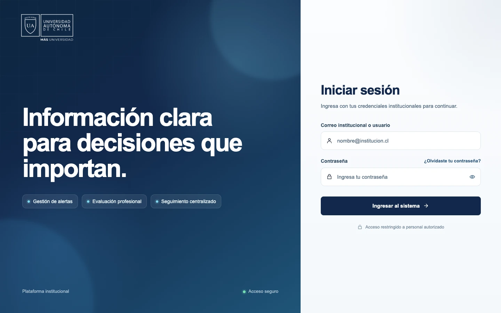
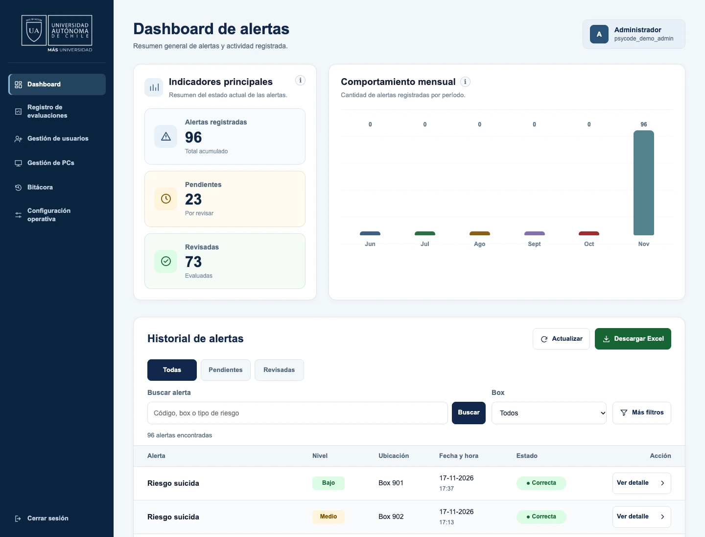
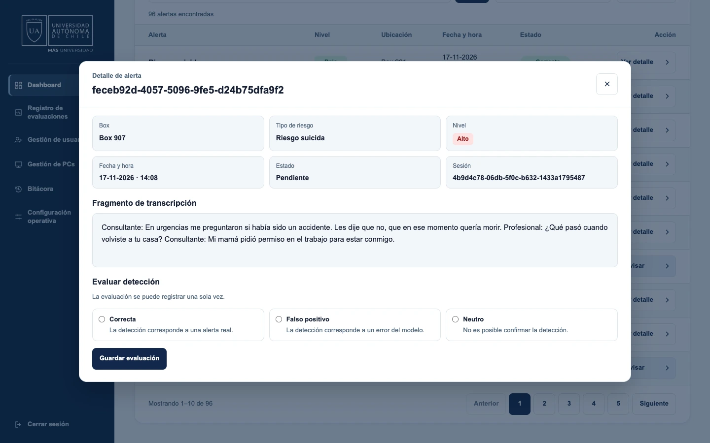
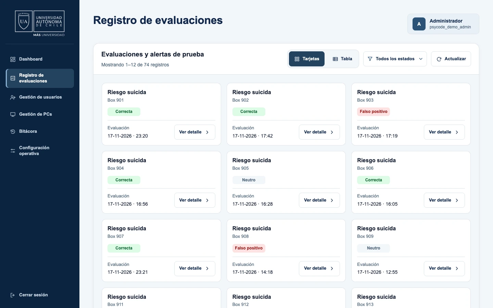
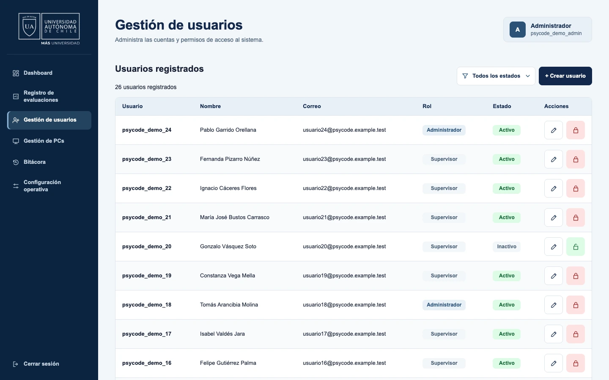
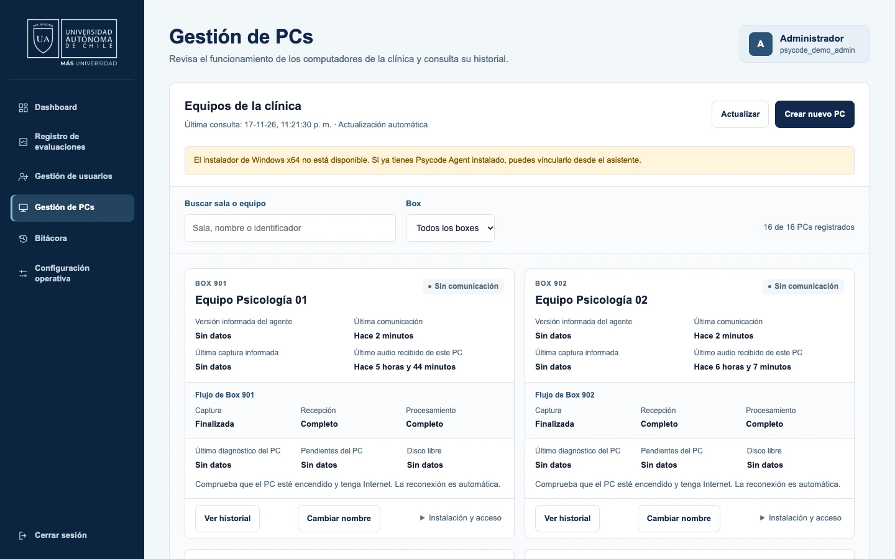
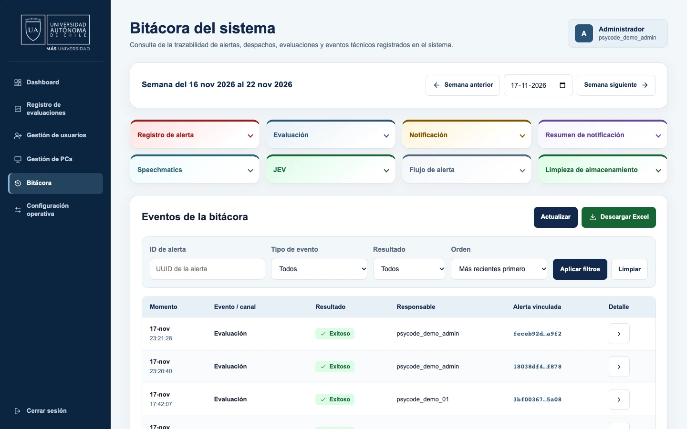
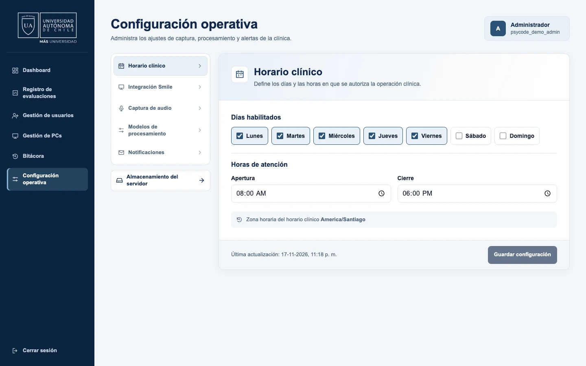
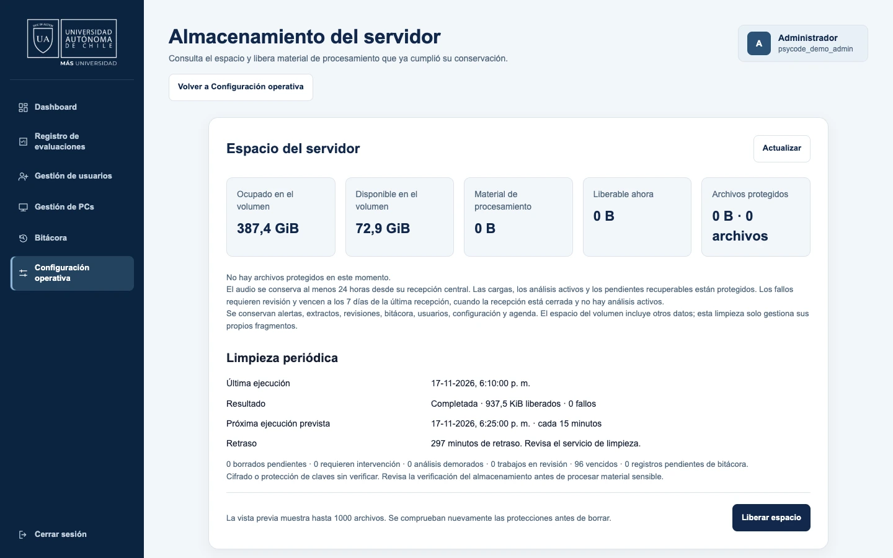

# Psycode · Manual de usuario

Psycode permite consultar las alertas generadas durante las sesiones clínicas, revisar las detecciones y registrar el resultado de cada evaluación. Desde el menú lateral, los supervisores acceden al **Dashboard** y al **Registro de evaluaciones**. Los administradores también pueden gestionar usuarios y PCs, consultar la bitácora y modificar la configuración operativa.

Las capturas de este manual muestran cuentas y datos ficticios.

- [Iniciar sesión y recuperar la contraseña](#iniciar-sesión-y-recuperar-la-contraseña)
- [Consultar y revisar alertas](#consultar-y-revisar-alertas)
- [Consultar el registro de evaluaciones](#consultar-el-registro-de-evaluaciones)
- [Gestión de usuarios](#gestión-de-usuarios)
- [Gestión de PCs](#gestión-de-pcs)
- [Consultar la bitácora](#consultar-la-bitácora)
- [Configuración operativa](#configuración-operativa)
- [Almacenamiento del servidor](#almacenamiento-del-servidor)

## Iniciar sesión y recuperar la contraseña

1. Abre en el navegador la dirección de Psycode que te entregó tu institución.
2. Completa **Correo institucional o usuario** y **Contraseña**.
3. Selecciona **Ingresar al sistema**. Se abrirá el Dashboard.

Si olvidaste tu contraseña, selecciona **¿Olvidaste tu contraseña?**, ingresa tu correo institucional y pulsa **Enviar instrucciones**. Abre el enlace que recibas por correo, escribe y confirma tu nueva contraseña, y vuelve a iniciar sesión.

Cuando termines, selecciona **Cerrar sesión** en el menú lateral.

## Consultar y revisar alertas

1. Abre **Dashboard** para ver el total de alertas registradas, pendientes y revisadas, junto con el gráfico mensual.
2. Baja a **Historial de alertas**. Selecciona **Pendientes** para encontrar las alertas por revisar o **Revisadas** para consultar las que ya tienen evaluación.
3. Busca por código, box o tipo de riesgo. Usa **Más filtros** para acotar por fechas o por resultado de la revisión.
4. Usa **Actualizar** para refrescar el panel o **Descargar Excel** para exportar el historial según los filtros aplicados.

### Registrar una evaluación

1. En la fila de una alerta pendiente, selecciona **Revisar**.
2. Comprueba el box, el tipo de riesgo y el nivel, y lee el **Fragmento de transcripción** si está disponible. Si estás revisando una alerta de prueba, pulsa **Ver transcripción** para mostrarlo.
3. En **Evaluar detección**, selecciona **Correcta**, **Falso positivo** o **Neutro** según tu revisión.
4. Comprueba tu selección y pulsa **Guardar evaluación**. La evaluación se registra una sola vez. Para consultarla después, abre **Ver detalle** en la alerta revisada.

## Consultar el registro de evaluaciones

1. Abre **Registro de evaluaciones** en el menú lateral.
2. Elige **Tabla** o **Tarjetas** y usa el filtro de estado para acotar el listado. Las alertas de audio de prueba se identifican con la etiqueta **Alerta de prueba**.
3. Selecciona **Evaluar** en un registro pendiente. En un registro ya evaluado, abre el detalle para ver el resultado, quién lo registró y cuándo.

## Gestión de usuarios

Disponible para administradores.

1. Abre **Gestión de usuarios** y pulsa **Crear usuario**.
2. Completa el usuario, nombre, correo y contraseña inicial. Asigna el rol **Supervisor** o **Administrador**, selecciona el estado y confirma con **Crear usuario**.
3. Para modificar una cuenta existente, usa **Editar** y pulsa **Guardar cambios**. Para quitarle o devolverle el acceso, usa la acción **Desactivar** o **Activar** y confirma.

## Gestión de PCs

Disponible para administradores.

Busca el equipo por sala, nombre o identificador, o filtra por **Box**. En la tarjeta del PC puedes consultar su conexión, el estado de la captura y el flujo de audio. Selecciona **Ver historial** para revisar eventos por fechas. Si el equipo aparece **Sin comunicación**, comprueba que esté encendido y conectado a Internet.

### Vincular un PC de la clínica

1. En el equipo Windows, abre **Gestión de PCs** y selecciona **Descargar instalador para Windows x64** si está disponible. Ejecuta el instalador con la cuenta de Windows que usa OBS.
2. En Psycode, pulsa **Crear nuevo PC**, elige un box disponible, escribe un nombre para el equipo y selecciona **Preparar instalación**.
3. En la sección **Vinculación** del asistente de Windows, introduce la dirección de Psycode y el código temporal que aparecen en la pantalla. Pulsa **Vincular e iniciar**.
4. Vuelve a **Gestión de PCs** y comprueba que el equipo figure como **Conectado**. Si el código vence antes de vincularlo, abre **Instalación y acceso** en la tarjeta del mismo equipo y selecciona **Generar otro código**.

## Consultar la bitácora

Disponible para administradores.

1. Abre **Bitácora** y selecciona la semana que quieras consultar con los botones de navegación o el selector de fecha.
2. Para acotar la búsqueda, usa **ID de alerta**, **Tipo de evento**, **Resultado** u **Orden**. Pulsa **Aplicar filtros**.
3. Abre **Ver detalle** en un evento para consultar su contexto. Usa **Descargar Excel** para exportar los resultados del período y los filtros seleccionados.

## Configuración operativa

Disponible para administradores. Abre **Configuración operativa**, selecciona la sección que quieras modificar y pulsa **Guardar configuración** cuando termines.

| Sección | Qué puedes ajustar |
| --- | --- |
| **Horario clínico** | Días habilitados y horas de apertura y cierre. |
| **Integración Smile** | PC colector de la agenda, formato de los reportes y boxes cubiertos. |
| **Captura de audio** | Modo **Duración fija** o **Sesión completa**. En duración fija, ajusta la longitud de los fragmentos. |
| **Modelos de procesamiento** | Modelos para transcribir el audio y analizar las sesiones, y umbral de Jev. |
| **Notificaciones** | Envío a una **Lista de distribución** o a **Supervisores activos**, y correo de respaldo si corresponde. |

## Almacenamiento del servidor

Disponible para administradores.

1. En **Configuración operativa**, abre **Almacenamiento del servidor**. Revisa el espacio disponible, el material protegido y la información de **Limpieza periódica**.
2. Para retirar material que ya cumplió su plazo de conservación, selecciona **Liberar espacio** y revisa la cantidad de archivos y el espacio indicado en la vista previa.
3. Selecciona **Confirmar limpieza** para continuar o **Cancelar** para volver al panel.

