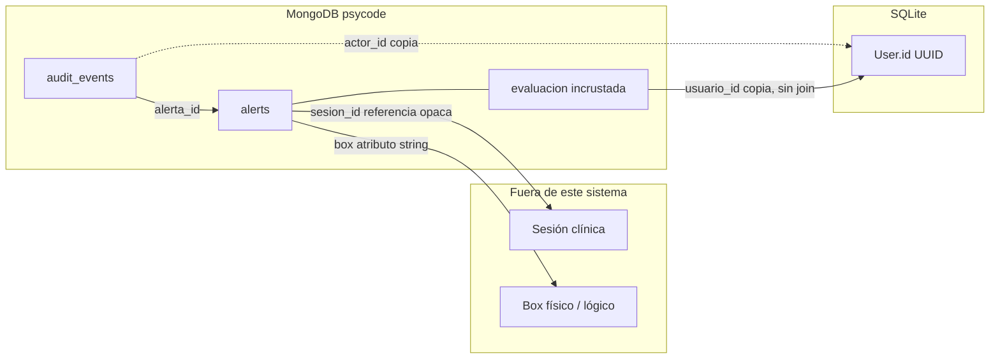

# Estructura de MongoDB — Psycode API

**Estado:** diseño de persistencia para SCRUM-32, 33, 34 y 41. No implementa la conexión ni carga datos de prueba. Complementa [ARCHITECTURE.md](../ARCHITECTURE.md) y [API_CONTRACTS.md](../API_CONTRACTS.md). Artefactos ejecutables en [mongodb/](mongodb/).

La base `psycode` (variable `MONGODB_DATABASE`) guarda la información persistente de alertas, evaluaciones e historial de eventos del dominio. Los usuarios y las sesiones de autenticación permanecen en SQLite. No hay join ni transacción entre las dos bases.

## 1. Colecciones

| Colección | Propósito | Mutación en v1 |
|---|---|---|
| `alerts` | Registro, historial, detalle y evaluación de alertas | Inserción; una actualización atómica al evaluar |
| `audit_events` | Bitácora consultable de eventos relevantes del dominio | Solo inserción |

No existen colecciones de sesiones clínicas, boxes, pacientes, evaluaciones sueltas, usuarios ni notificaciones. Esas nociones se modelan como se indica en la sección 3.

El nombre técnico de la base es `psycode`. `_id` es ObjectId interno de MongoDB y **nunca** se expone en la API.

## 2. Decisiones

1. **Una alerta, un documento.** Historial, detalle, dashboard y evaluación leen la misma colección. No hay proyección histórica del estado de evaluación: se muestra el estado actual.
2. **Evaluación incrustada.** Una sola evaluación por alerta, objeto `evaluacion` o `null`. La escritura es atómica y condicionada a `estado_evaluacion=pendiente`, que es el mecanismo del 201/409 concurrente. Una colección aparte exigiría transacción multi-documento sin beneficio en v1.
3. **Box y sesión no son entidades.** `box` es un atributo string; `sesion_id` es una referencia opaca al sistema clínico externo. El backlog no incluye CRUD de boxes ni de sesiones.
4. **Semáforo derivado.** `semaforo` se calcula desde `nivel_severidad` (Anexo A). El documento lo materializa para filtrar y notificar, pero no es una segunda autoridad.
5. **Bitácora aparte, no un arreglo en la alerta.** `audit_events` registra alta, evaluación e intentos de aviso sin inflar el documento clínico ni mezclar autenticación.
6. **Identidad en SQLite, copia de trazabilidad en MongoDB.** `usuario_id` y `usuario` se copian al evaluar. Un cambio posterior de nombre en SQLite no reescribe evaluaciones ya guardadas.
7. **PyMongo y validador JSON Schema.** No hay modelos ORM Django para estas colecciones. El validador de servidor refuerza tipos e invariantes; el dominio en `backend/apps/alerts/domain.py` es la fuente de las reglas.

## 3. Relaciones e identificadores



| Relación | Cardinalidad | Cómo se materializa | Qué no es |
|---|---|---|---|
| Alerta → evaluación | 1:0..1 | Campo `evaluacion` en el mismo documento | Colección `evaluations` |
| Alerta → box | N:1 lógica | String `box`, coincidencia exacta y sensible a mayúsculas | Catálogo ni `_id` de box |
| Alerta → sesión clínica | N:1 lógica | UUID `sesion_id` | Sesión JWT ni documento `sessions` |
| Evaluación → profesional | N:1 lógica | `usuario_id` + `usuario` copiados al evaluar | Foreign key SQL ni ObjectId de User |
| Evento de bitácora → alerta | N:1 | `audit_events.alerta_id` = `alerts.alerta_id` | Transacción distribuida |

Una sesión puede originar varias alertas; un box aparece en muchas alertas. No se impone unicidad sobre `sesion_id` ni sobre `box`.

### Identificadores

| Identificador | Dónde vive | Formato | Reglas |
|---|---|---|---|
| `alerta_id` | `alerts`, copiado en `evaluacion` y `audit_events` | UUID canónico minúsculas con guiones | Público, único, inmutable. Lo aporta el caso de uso interno de registro para detectar duplicados |
| `sesion_id` | solo `alerts` | UUID canónico | Referencia externa; no se resuelve en este backend |
| `usuario_id` | `evaluacion`, `audit_events.actor_id` | UUID canónico = `User.id` de SQLite | Lo asigna el servidor desde el JWT, nunca el JSON del cliente |
| `usuario` | `evaluacion` | string 1–150 | Nombre de usuario visible **al evaluar**, no correo |
| `event_id` | `audit_events` | UUID canónico | Identificador del evento de bitácora |
| `box` | `alerts` | string 1–64 | Identificador de box; no UUID |
| `_id` | ambas colecciones | ObjectId | Interno; no se usa como identificador de negocio |

No se almacenan identificadores de paciente, RUT, ficha clínica ni `jti` de JWT junto a la alerta.

## 4. Colección `alerts`

Documento de negocio. Las fechas se guardan como BSON Date UTC y se serializan ISO 8601 con `Z` en la API.

### Campos

| Campo | Tipo persistido | Obligatorio | Origen | Notas |
|---|---|---|---|---|
| `alerta_id` | string UUID | Sí | Caso de uso interno | Índice único |
| `box` | string 1–64 | Sí | Entrada interna | Se recortan extremos al persistir; el filtro público es exacto |
| `tipo_riesgo` | string 1–100 | Sí | Entrada interna | Sin catálogo cerrado inventado |
| `nivel_severidad` | int 1–3 | Sí | Entrada interna | No booleano; insertar Int32; NULO/sin riesgo no se persiste |
| `semaforo` | enum | Sí | **Derivado** | Ver sección 5 |
| `fecha_hora` | date UTC | Sí | Entrada interna | Detección, no evaluación |
| `estado_evaluacion` | enum | Sí | Servidor | `pendiente` al alta |
| `evaluacion` | objeto o null | Sí (null cuenta) | Servidor | `null` al alta |
| `sesion_id` | string UUID | Sí | Entrada interna | No se expone en el listado, sí en el detalle |
| `descripcion` | string ≤500 o null | Sí como campo; valor null permitido | Entrada interna opcional | Fragmento relevante de transcripción asociado a la alerta; se normalizan espacios y Unicode; ausente o vacío → `null` |
| `trazabilidad.registrada_en` | date UTC | Sí | Reloj del servidor | |
| `trazabilidad.actualizada_en` | date UTC | Sí | Reloj del servidor | Igual a `registrada_en` al alta; se actualiza al evaluar |
| `trazabilidad.origen` | string 1–100 | Sí | Entrada interna | p. ej. `datos_sinteticos` |

Opcional en la **entrada** de registro: solo `descripcion`. El resto de campos de alerta los aporta el llamador interno o los asigna el servidor. El llamador **no** es autoridad de `semaforo`, `estado_evaluacion`, `evaluacion` ni fechas de trazabilidad.

### Subdocumento `evaluacion`

Presente si y solo si la alerta no está pendiente. Misma forma que el contrato Evaluation.

| Campo | Tipo | Obligatorio | Origen |
|---|---|---|---|
| `alerta_id` | UUID | Sí | Copia del padre |
| `evaluacion` | `correcta` \| `falso_positivo` \| `neutro` | Sí | POST autenticado |
| `usuario_id` | UUID | Sí | Usuario autenticado |
| `usuario` | string | Sí | Username al evaluar |
| `fecha_hora` | date UTC | Sí | Reloj del servidor |
| `estado_evaluacion` | igual a `evaluacion` | Sí | Servidor |

No hay edición ni segunda evaluación en v1.

### Invariantes (dominio + validador)

- `nivel_severidad` solo puede ser 1, 2 o 3.
- `semaforo` = f(`nivel_severidad`) según la tabla de la sección 5.
- `estado_evaluacion = pendiente` ⇔ `evaluacion is null`.
- Si hay evaluación: `evaluacion.alerta_id = alerta_id` y `evaluacion.evaluacion = evaluacion.estado_evaluacion = estado_evaluacion`.
- `trazabilidad.actualizada_en >= trazabilidad.registrada_en`.
- Evaluar no cambia `nivel_severidad`, `semaforo` ni `fecha_hora` de detección.

Validador: [mongodb/alerts.validator.json](mongodb/alerts.validator.json). Ejemplos: [pendiente](mongodb/examples/alert-pendiente.json), [evaluada](mongodb/examples/alert-evaluada.json).

### Escritura atómica de evaluación

```text
updateOne(
  { alerta_id, estado_evaluacion: "pendiente" },
  { $set: { evaluacion, estado_evaluacion, "trazabilidad.actualizada_en" } }
)
```

`matchedCount = 1` → 201. Si es 0, un `find` por `alerta_id` distingue 404 (`ALERTA_NO_ENCONTRADA`) de 409 (`EVALUACION_YA_REGISTRADA`). Dos POST concurrentes no pueden incrustar dos evaluaciones.

## 5. Estados y niveles de severidad

### Escala operativa y semáforo

| `nivel_severidad` | Categoría operativa | `semaforo` |
|---|---|---|
| 1 | Riesgo bajo | `BAJO` |
| 2 | Riesgo medio | `MEDIO` |
| 3 | Riesgo alto | `ALTO` |

Implementación: `semaforo_desde_severidad` en [domain.py](../backend/apps/alerts/domain.py). Un resultado NULO/sin riesgo no se registra como alerta. El dashboard conserva la clave `nulo` en cero por compatibilidad; el documento persiste solo `BAJO`, `MEDIO` o `ALTO`. Un falso positivo **no** altera la severidad almacenada ni se excluye de los totales.

### Actualización de la escala histórica

Ejecutar una sola vez antes de desplegar el backend con el validador 1–3. Detener temporalmente las escrituras a `alerts`; los eventos de auditoría se conservan. El modo `warn` permite convertir los documentos mientras el validador antiguo aún espera el semáforo anterior:

```javascript
db.runCommand({ collMod: "alerts", validationAction: "warn" })

db.alerts.deleteMany({ nivel_severidad: 0 })

db.alerts.updateMany(
    { nivel_severidad: { $gte: 1, $lte: 7 } },
    [{ $set: {
        nivel_severidad: {
            $switch: {
                branches: [
                    { case: { $lte: ["$nivel_severidad", 2] }, then: 1 },
                    { case: { $lte: ["$nivel_severidad", 4] }, then: 2 }
                ],
                default: 3
            }
        },
        semaforo: {
            $switch: {
                branches: [
                    { case: { $lte: ["$nivel_severidad", 2] }, then: "BAJO" },
                    { case: { $lte: ["$nivel_severidad", 4] }, then: "MEDIO" }
                ],
                default: "ALTO"
            }
        }
    } }]
)

db.alerts.countDocuments({
    $or: [
        { nivel_severidad: { $lt: 1 } },
        { nivel_severidad: { $gt: 3 } },
        { semaforo: "NULO" }
    ]
})
```

La conversión conserva el semáforo anterior: 1–2 → 1/BAJO, 3–4 → 2/MEDIO y 5–7 → 3/ALTO. El nivel 0 se retira porque no representa una alerta de riesgo. Confirmar que la última consulta devuelve `0`; desplegar entonces el backend nuevo, cuyo `ensure_schema` aplica el validador estricto. No reanudar escrituras antes de esa aplicación. Después de migrar, recrear las alertas sintéticas con `seed_demo_alerts --reset`.

### Estado de evaluación

| Valor persistido | Significado | ¿Revisada? | ¿Se puede registrar por POST? |
|---|---|---|---|
| `pendiente` | Sin evaluación | No | No |
| `correcta` | El profesional confirma la alerta | Sí | Sí |
| `falso_positivo` | El profesional descarta la alerta | Sí | Sí |
| `neutro` | Ni confirmación ni falso positivo | Sí | Sí |

`revisadas=true` en el listado es `estado_evaluacion ∈ {correcta, falso_positivo, neutro}`. No existe un campo booleano `revisada`.

## 6. Colección `audit_events` (bitácora)

Eventos relevantes del **dominio persistido en MongoDB**: alta de alerta, registro de evaluación e intento de notificación. Es complementaria al logger `psycode.audit`.

| Qué | Dónde |
|---|---|
| `alerts.register`, `alerts.evaluate`, `notifications.send` | MongoDB `audit_events` **y** logger |
| `auth.login`, `auth.refresh`, `auth.logout`, `auth.password_reset`, `api.error` | Solo logger Django (identidad en SQLite) |

Un fallo al insertar en `audit_events` no revierte la alerta ni se presenta como prueba de entrega. El evento ya emitido al log permanece. La colección es de solo inserción: no se actualiza ni se borra en v1.

### Campos

| Campo | Tipo | Obligatorio | Null permitido | Uso |
|---|---|---|---|---|
| `event_id` | UUID | Sí | No | Identificador del evento |
| `timestamp` | date UTC | Sí | No | Hora de registro |
| `action` | enum de las tres acciones | Sí | No | Tipo de evento |
| `outcome` | `success` \| `failure` \| `skipped` | Sí | No | Resultado |
| `actor_id` | UUID | Sí como campo | Sí | Profesional que evalúa; null en alta/envío |
| `alerta_id` | UUID | Sí | No | Relación con `alerts` |
| `channel` | `teams` \| `email` | Sí como campo | Sí | Canal que aceptó el aviso |
| `contingencia` | bool | Sí como campo | Sí | Correo por fallo de Teams |
| `motivo` | `sin_riesgo` \| `deshabilitada` \| `ningun_canal_acepto` | Sí como campo | Sí | Por qué se omitió o falló el envío |
| `error_code` | string `A-Z0-9_` | Sí como campo | Sí | Código estable, no mensaje de proveedor |
| `duration_ms` | int ≥ 0 | Sí como campo | Sí | Duración total del envío |
| `intentos` | arreglo | Sí | No (vacío) | Detalle por canal; vacío si no hay envío |

Validador e índices: [audit_events.validator.json](mongodb/audit_events.validator.json), [audit_events.indexes.json](mongodb/audit_events.indexes.json). Ejemplos de alta, evaluación y contingencia Teams→correo en [mongodb/examples/](mongodb/examples/).

## 7. Índices y consultas cubiertas

Definición: [alerts.indexes.json](mongodb/alerts.indexes.json).

| Índice | Consultas |
|---|---|
| `alerta_id` único | Detalle, GET/POST evaluación, duplicado en el alta |
| `fecha_hora` desc + `alerta_id` asc | Listado por defecto, rangos `fecha_desde`/`fecha_hasta`, dashboard |
| `box` + `fecha_hora` desc + `alerta_id` | Filtro exacto de box con fechas |
| `estado_evaluacion` + `fecha_hora` desc + `alerta_id` | Filtro de estado y `revisadas` |

`q` es subcadena literal sin distinguir mayúsculas sobre `alerta_id`, `box` y `tipo_riesgo`, combinada con AND al resto de filtros. No se interpreta como regex ni como consulta MongoDB. No hay índice de texto ni motor de búsqueda externo: el volumen esperado de una clínica no lo exige. La colección **no** usa collation case-insensitive porque el filtro `box` es sensible a mayúsculas.

No se indexa `sesion_id`: ninguna ruta pública filtra por sesión.

## 8. Trazabilidad y auditoría

Tres capas, con responsabilidades distintas:

| Capa | Dónde | Qué prueba |
|---|---|---|
| Trazabilidad de la alerta | `alerts.trazabilidad` | Cuándo se persistió, cuándo cambió (evaluación) y de qué origen |
| Trazabilidad de la evaluación | `alerts.evaluacion` | Quién (UUID + username de entonces), qué resultado y cuándo |
| Bitácora de eventos | `audit_events` + logger | Alta, evaluación, cada intento de Teams/correo, contingencia y códigos de error |

La evaluación no se reconstruye consultando SQLite. El profesional llega del contexto autenticado. Los intentos de notificación no forman parte del documento público de alerta: viven en la bitácora para no ampliar el contrato HTTP.

## 9. Información que no debe almacenarse

Prohibido en MongoDB, en logs y en notificaciones, salvo mención explícita:

| Dato | Motivo |
|---|---|
| Grabaciones de audio o fragmentos | RF-11 / handoff; fuera de alcance |
| Transcripción completa de la sesión | No se almacena la transcripción completa; únicamente puede persistirse en `descripcion` el fragmento relevante asociado a la alerta |
| Nombre, RUT, ficha u otros datos personales del paciente | Minimización; las notificaciones solo llevan box, tipo, semáforo y fecha |
| Detalles operativos de métodos suicidas | Reglas de uso del insumo clínico |
| Frecuencias inventadas | Si no hay dato, no se fabrica; no hay campo de frecuencia |
| Contraseñas, JWT, tokens de recuperación, URLs de Teams u otros secretos | Cuentas y secretos no pertenecen a estas colecciones |
| Correo del profesional dentro de `evaluacion` o de la bitácora | Se guarda `usuario_id` y `usuario`, no `correo` |
| Cuerpos libres de error de Teams/SMTP | Solo `error_code` de lista controlada |
| `semaforo` o estado enviados por el cliente como autoridad | Se derivan o asignan en servidor |
| Identificador de sesión JWT como `sesion_id` | Son conceptos distintos |
| ObjectId de Mongo como identificador público | La API usa UUID |
| Roles, permisos o réplica del usuario Django | Identidad en SQLite |
| Segunda evaluación, historial de ediciones o borrado lógico de alertas | Fuera de v1 |

`descripcion` existe en el contrato como campo opcional de máximo 500 caracteres y representa únicamente el fragmento relevante de transcripción asociado a la alerta. No debe utilizarse para almacenar 
la transcripción completa de la sesión, audio original, identidad del paciente ni otros datos ajenos al contexto mínimo de la alerta. El alta interna normaliza espacios y caracteres Unicode; la ausencia o un valor vacío se normalizan a `null`, y el contenido que supere el límite se rechaza.

## 10. Correspondencia con el contrato y las tareas

| Necesidad | Colección / campo |
|---|---|
| Registrar alertas generadas | Insert en `alerts` vía `register_alert` |
| Consultar historial y filtros | `GET /alerts` sobre `alerts` e índices de la sección 7 |
| Detalle | Mismos campos más `sesion_id`, `descripcion`, `trazabilidad` |
| Evaluar | `$set` atómico de `evaluacion` + estado + `actualizada_en` |
| Registro de evaluaciones (SCRUM-40) | Listado `revisadas=true`; cada fila trae `evaluacion` |
| Dashboard | Agregación por `fecha_hora` y `semaforo` / `estado_evaluacion` actuales |
| Bitácora | `audit_events` |
| Notificar | No se persiste un documento de notificación; el resultado va a la bitácora |

SCRUM-32 implementa conexión, variables `MONGODB_URI` / `MONGODB_DATABASE`, aplicación de validadores e índices, mapeo PyMongo ↔ tipos de `domain.py` y al menos cinco alertas sintéticas variadas. Este documento no crea esa conexión.

## 11. Supuestos explícitos

- Varias alertas pueden compartir `sesion_id` o `box`.
- No hay caducidad (TTL) de `audit_events` en v1; la retención se define antes de uso clínico real.
- No hay garantía de entrega de la bitácora si MongoDB cae después de persistir la alerta.
- La escala persistida del proyecto es 1–3; NULO/sin riesgo queda fuera de `alerts`. Los valores 0–7 solo se usan para la migración histórica documentada arriba.

Fuentes: contratos 1.2, arquitectura SCRUM-30, insumo clínico, `AuditWriter` y las descripciones de SCRUM-32/33/34/41 en el [handoff](../HANDOFF.md).
